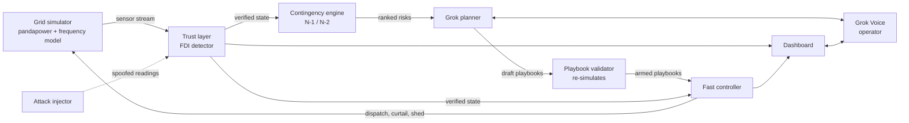

# GridGovernor Design Doc

Sep 26, 2026 · @Nandu

## TL;DR

GridGovernor is a grid defense copilot for the SpaceXAI track: Grok plans blackout responses ahead of time, fast controllers execute them in milliseconds, and a detection layer catches spoofed sensor data. The core design choice is two timescales: an LLM can't sit in a 200 ms control loop, so Grok works in the seconds-to-hours window (planning, explaining, follow-up decisions) while deterministic controllers handle the first second after a fault.

The demo: a transformer trips during a simulated heat wave, a pre-armed playbook stabilizes frequency in a 200 ms simulated window while Grok narrates, then an attacker injects fake sensor data and GridGovernor catches it before it triggers a harmful load shed.

## Background & problem

Grid failures cascade faster than humans can react. When a major component trips, power flow instantly reroutes onto neighboring lines, which can overload and trip in turn. The 2003 Northeast blackout grew from a few line trips into a failure affecting roughly 50 million people in hours, with the fastest stage unfolding in minutes.

Three trends make this worse:

- **Extreme heat:** heat waves push demand to peaks while heat also lowers how much power lines and transformers can safely carry.
- **Less inertia:** as spinning coal and gas generators are replaced by solar, wind and batteries, the grid has less physical inertia, so frequency falls faster after a fault.
- **Cyber-physical attacks:** attackers can spoof sensor readings (false data injection) so operators or automated systems take harmful actions based on a fake picture of the grid.

Today, fast automatic protection (relays, under-frequency load shedding) is blunt: it sheds load by feeder, not by importance, so hospitals and cooling centers can go dark with everyone else. Smarter planning happens offline and slowly. GridGovernor closes that gap: smart planning done ahead of time, executed at machine speed, on data that's been checked for tampering.

## Goals and non-goals

**Goals for the hackathon build**

1. Simulate a standard IEEE test grid (IEEE 39-bus "New England" system) with power flow and a simplified frequency model.
2. Run N-1 contingency analysis automatically and rank the most dangerous single failures.
3. Have Grok generate priority-aware response playbooks for the top contingencies, validated against the simulator before they're armed.
4. Execute an armed playbook within a 200 ms simulated window when a fault fires.
5. Detect a false data injection attack using state-estimation residuals and physics consistency checks.
6. Let an operator query the system hands-free through Grok Voice.
7. Show all of it on a live dashboard: grid map, frequency trace, playbook status, alerts.

**Non-goals**

- Controlling real equipment, or integrating with real SCADA or utility systems.
- Putting an LLM in the fast control loop. Grok never acts in the sub-second window.
- Full electromagnetic-transient accuracy. A single-area frequency model is enough for the demo.
- N-2 analysis across every pair of components. We run it only for a short list of pairs, since the full set is too slow for a live demo.
- Production-grade security. The attack detection is a proof of concept on simulated data.

## System architecture

GridGovernor runs on two timescales. The **planning layer** (Grok) works in the seconds-to-hours window: it studies contingencies, writes playbooks and explains decisions. The **execution layer** (deterministic code) works in the sub-second window: it watches for faults and fires armed playbooks instantly. A **trust layer** sits between the sensors and both layers, so neither acts on tampered data.

**Data flow**

1. The simulator publishes bus voltages, line flows, frequency and breaker states every 50 ms of simulated time.
2. The trust layer checks each reading against a physics-based state estimate and flags anything inconsistent before it reaches the rest of the system.
3. The contingency engine reruns N-1 analysis whenever load or weather conditions shift meaningfully, and ranks the failures that would cause overloads or frequency collapse.
4. Grok turns the top-ranked risks into playbooks. The validator re-simulates each one, and only passing playbooks are armed.
5. When a fault fires, the controller matches it to an armed playbook and executes it within the 200 ms window. If there's no match, it falls back to standard under-frequency load shedding.
6. Grok handles the follow-up: rebalancing over the next minutes, explaining what happened, and answering the operator by voice.

## Component design

### 1. Grid simulator

- **Steady state:** pandapower loads the IEEE 39-bus case and solves AC power flow for voltages and line loadings.
- **Frequency:** a single-area swing-equation model tracks system frequency after a generation-load imbalance. It includes generator droop response, battery fast-frequency response, and a tunable inertia constant so we can show a low-inertia grid falling faster.
- **Scenarios:** a scenario file scales load for heat-wave peaks, derates line ratings with temperature, and schedules fault events.
- **Output:** publishes grid state every 50 ms of simulated time over a WebSocket.

### 2. Contingency engine

- Removes each line, transformer and generator one at a time (N-1), re-solves power flow, and records overloads, voltage violations and estimated frequency drop.
- Ranks contingencies by a severity score: total overload, lowest voltage, and frequency nadir (the lowest point frequency reaches).
- N-2 runs only on pairs drawn from the top 10 N-1 results, to keep runtime within seconds.

### 3. Grok planner

- Input: the ranked contingencies, current grid state, available resources (battery capacity and location, curtailable renewables, sheddable feeders) and a priority list of critical loads (hospitals, cooling centers, water pumping).
- Output: a playbook in strict JSON, with the trigger event, ordered actions (battery MW per bus, curtailment MW, feeders to shed with priority) and a plain-English rationale.
- Grok never writes free-form commands. The JSON schema limits it to actions the controller understands, within resource limits.

### 4. Playbook validator

- Re-runs the simulator with the trigger fault and the playbook applied, and checks that frequency stays above 59.5 Hz, no line exceeds 100% of its rating, and no critical load is shed.
- Failing playbooks go back to Grok with the failure reason for one repair attempt. If the repair also fails, the contingency is marked uncovered, and standard protection applies.

### 5. Fast controller

- Watches the verified grid state for breaker trips that match an armed playbook's trigger.
- On a match, executes the playbook's actions within the 200 ms simulated window. Pure deterministic code, no network calls.
- Falls back to conventional under-frequency load shedding if a fault has no armed playbook.

### 6. Trust layer (false data injection detector)

- **State-estimation residuals:** runs weighted least-squares state estimation and flags measurements whose residuals exceed a threshold (the standard bad-data test).
- **Physics consistency:** catches stealthier attacks crafted to pass the residual test, by checking readings against physical laws: power balance at each bus, line limits, and whether a sudden change matches any real event.
- **Cross-checks:** compares redundant measurements, like both ends of a line or phasor-style readings where available.
- Flagged readings are quarantined, and the controller acts only on the verified estimate.

### 7. Grok Voice operator interface

- The operator talks to Grok Voice with tool calls into the system: get grid state, list armed playbooks, explain an alert, approve or reject a pending action.
- Grok narrates events as they happen: what tripped, what fired, what's next.
- Any action Grok proposes outside an armed playbook needs spoken operator approval.

### 8. Dashboard

- Grid map with lines colored by loading, a live frequency trace with the 59.5 Hz floor marked, a playbook panel (armed, fired, uncovered) and an alert feed showing flagged sensor readings.

## Demo scenario

The demo runs 3 minutes on a scripted scenario file, so every run is identical and nothing depends on venue Wi-Fi except the Grok calls.

| Time | What happens on screen | What Grok says or does |
| --- | --- | --- |
| 0:00–0:30 | Grid map at normal load. Heat wave begins, and load climbs toward peak. | Operator asks: "What's our biggest risk right now?" Grok names the transformer whose loss causes the worst overload. |
| 0:30–1:00 | Contingency engine ranks risks. Three playbooks show as armed. | Grok explains one playbook in plain English, including that the hospital feeders are protected. |
| 1:00–1:45 | The transformer trips. Frequency drops, then the armed playbook fires within 200 ms of simulated time. Batteries discharge, one low-priority feeder sheds, and frequency recovers above 59.5 Hz. | Grok narrates the recovery as it happens and proposes a follow-up rebalance. The operator approves by voice. |
| 1:45–2:30 | Attacker injects fake readings showing a critical line overloaded, which would trigger shedding a neighborhood. Alert feed flags the readings. | Grok explains why the readings are fake: power doesn't balance at that bus, and the line's other end disagrees. No load is shed. |
| 2:30–3:00 | Side-by-side replay: the same fault without GridGovernor. Frequency falls through the floor, and blunt load shedding cuts the hospital. | Closing line on what was protected. |

**Backup plan:** pre-record the full run. If Grok's API is slow or down, play the recording and narrate live.

## Tech stack

| Layer | Choice | Why |
| --- | --- | --- |
| Grid simulation | Python, pandapower, NumPy | pandapower ships IEEE test cases and AC power flow out of the box |
| Frequency model | Custom swing-equation integrator in NumPy | Simple, fast, and tunable enough for the demo |
| Contingency engine | Python, multiprocessing | Runs N-1 cases in parallel so re-ranking takes seconds |
| Trust layer | Python, weighted least-squares state estimation (pandapower's estimator) | Standard bad-data detection plus our physics checks |
| Planner | Grok API (`grok-4.7`) with structured JSON output | Reasoning over contingencies plus a strict schema |
| Operator voice | Grok Voice realtime API with tool calls | Hands-free queries and approvals |
| Backend | FastAPI + WebSockets | Streams grid state to the dashboard at 20 Hz |
| Dashboard | React, D3 for the grid map, a lightweight chart library for the frequency trace | Live, readable visuals |
| Build tool | Cursor | Required by the SpaceXAI track |

## Build plan

This plan assumes a 36-hour hackathon and a team of 4. The rule: a working end-to-end demo by hour 20, then polish.

**Team split**

| Role | Owns |
| --- | --- |
| Sim lead | Simulator, frequency model, scenario files, contingency engine |
| Security lead | Trust layer, attack injector, fast controller |
| AI lead | Grok planner, playbook schema, validator loop, Grok Voice |
| Frontend lead | Dashboard, WebSocket streaming, demo recording |

**Milestones**

| Hours | Milestone | Done when |
| --- | --- | --- |
| 0–4 | Skeleton | IEEE 39-bus solves in pandapower, state streams to a bare dashboard, a Grok call returns a JSON playbook |
| 4–10 | Core loops | Frequency model responds to a trip, N-1 ranking works, the controller fires a hand-written playbook |
| 10–16 | Grok in the loop | Grok writes playbooks, the validator re-simulates them, and passing ones arm automatically |
| 16–20 | End-to-end | The full demo scenario runs start to finish, rough but working |
| 20–26 | Attack layer | The injector and the detector catch the spoofed-overload attack |
| 26–30 | Voice + narration | Grok Voice answers queries, narrates events and takes approvals |
| 30–34 | Polish | Dashboard visuals, side-by-side replay, backup recording |
| 34–36 | Submit | Write-up, repo cleanup, demo video, rehearsal |

**Before the event:** get Grok API keys, confirm the IEEE 39-bus case loads in pandapower, and prototype the swing-equation model, so hour 0 starts with working pieces.

## Risks and mitigations

| Risk | Impact | Mitigation |
| --- | --- | --- |
| Judges think an LLM is controlling the grid in real time | Credibility hit with anyone from power engineering | Lead the pitch with the two-timescale split; show that the controller is deterministic code |
| Grok writes a playbook that makes things worse | Bad demo, and a safety story that falls apart | Strict JSON schema, resource limits, and the validator must pass before anything arms |
| Grok API latency or outage during the demo | Narration stalls on stage | Pre-generate playbooks before the demo; keep a pre-recorded run as backup |
| Frequency model looks fake to experts | Loses technical judges | Use standard swing-equation parameters, and state its limits openly as a single-area model |
| Attack detection only catches naive attacks | Security story feels thin | Include a stealthy attack that passes the residual test and is caught by the physics checks |
| Scope creep, especially N-2 or a fancy map | End-to-end demo not ready by hour 20 | Hold the hour-20 checkpoint; cut N-2 and replay first if behind |
| Nobody on the team knows power systems | Slow simulator build | Prototype the simulator before the event; stick to pandapower's built-in cases |

## Differentiation and pitch

**One-line pitch:** GridGovernor plans for blackouts before they happen, stops them in milliseconds when they do, and can't be fooled by hackers faking the data.

**Why it fits the SpaceXAI track:** it tackles a societal problem (grid resilience under climate stress) that goes beyond everyday apps. Grok does the reasoning humans can't do fast enough, and Grok Voice makes it usable by an operator mid-crisis.

**Versus GridVeda (TreeHacks 2026):** [GridVeda](https://treehacks-2026.devpost.com/project-gallery) predicts when individual transformers are about to fail, using edge hardware. GridGovernor works at the system level: what happens to the whole grid when something fails, and whether the data can be trusted. The two are complementary. GridVeda-style predictions could decide which contingencies GridGovernor prepares playbooks for first.

|  | GridVeda | GridGovernor |
| --- | --- | --- |
| Question | Is this transformer getting sick? | If it fails now, does the grid cascade, and what's the plan? |
| Scope | Individual assets | The whole network |
| Timescale | Days to weeks before failure | Milliseconds to minutes after failure |
| Action | Flags equipment for maintenance | Executes dispatch, curtailment and priority load shedding |
| Attacker model | None | Detects false data injection |

## Open questions

- [ ] Is the IEEE 39-bus grid the right size, or should we drop to the 14-bus case for a simpler, more readable map?
